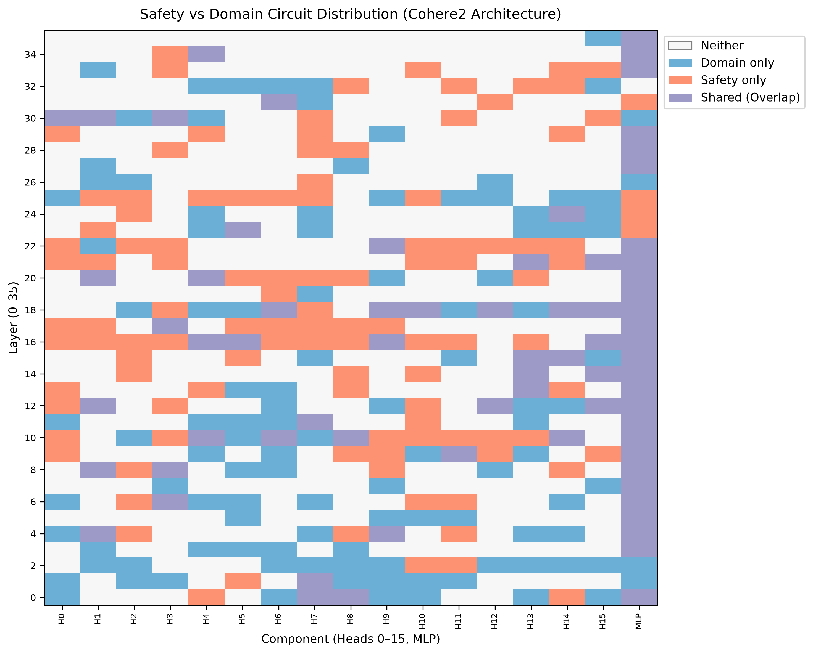
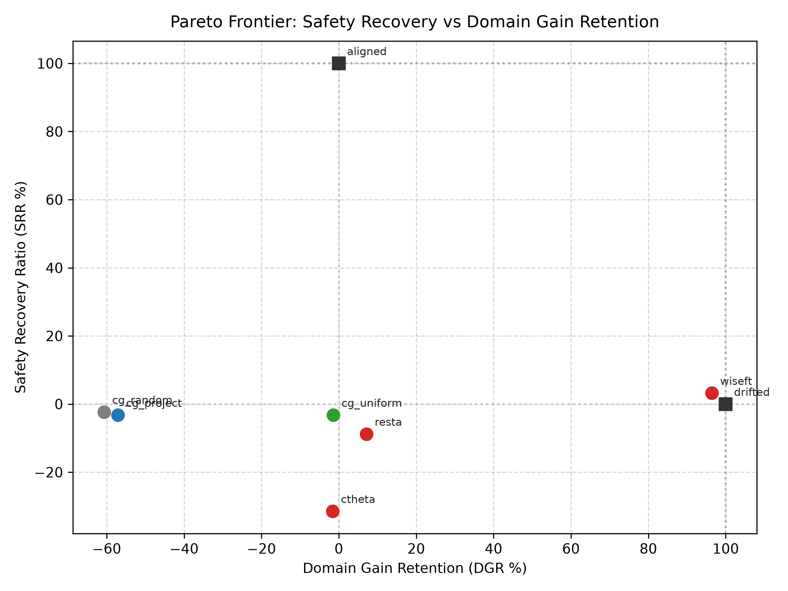

# CircuitGraft: circuit-aware safety recovery for domain-fine-tuned Cohere Tiny Aya

**Track 2b / Problem 6 — Lexsi Labs Hackathon**

> **Status: filled from the tracked S9 bundle `results/s9/report-1794803399/`
> (2026-11-16).** The Phase 4 core matrix ran end-to-end on Kaggle (T4) and the
> bundle status is **`partial`** for three disclosed reasons: the eval summary is
> partial (human audit pending review), the human audit itself is pending, and
> S8 attacks were not run. Every number below is copied from that bundle (or
> from the discover/eval artifacts it points at); nothing is hand-typed.
>
> **Scoring-fix disclosure.** The first eval merge (`eval-kaggle-merged`) scored
> MCQ golds wrong (letter gold vs option-text predictions → 0.0% everywhere).
> The bug was fixed in `circuitgraft.eval.domain`, regression-tested, and the
> MCQ arm was re-scored from the cached generations on CPU
> (`artifacts/eval/eval-rescored-20261116-042341/`, the run this article uses).
> The original summary is preserved unchanged as evidence. Safety/benign arms
> (string-match on text) were unaffected and are carried verbatim.
>
> **Do not** hand-type a number, copy one from a terminal, or quote a proxy/smoke
> run as Tiny Aya evidence. If a value is missing, keep `—` and say why.

## Abstract

Domain fine-tuning makes a model more useful in a target domain, but it can also
erode the refusal behavior learned during alignment. Whole-model recovery methods
restore safety at the cost of domain competence, while circuit-restricted methods
often optimize safety without asking which components the domain skill needs.
CircuitGraft maps a safety circuit and a domain circuit in the same attention-head
and MLP component space, partitions components into safety-only, domain-only and
shared sets, and grafts the safety delta back with domain-protected edits on the
shared set. We evaluate safety recovery, domain-gain retention and false refusal
against RESTA, WiSE-FT, C-ΔΘ (SafeTune weight-arithmetic implementation) and
Safe LoRA on Cohere Tiny Aya, using a medical fine-tuning scenario and
preregistered endpoints.

**Results:** On the preregistered default operating point, the G-drift gate
**failed on its refusal axis and passed its domain axis**: pooled harmful-prompt
refusal changed by only +2.3 points aligned→drifted (95% CI [−1.5, 6.2], needs
≥ 15 with CI > 0), while pooled domain accuracy gained +8.0 points (95% CI
[+2.9, +14.0], gate ≥ 3). SRR is therefore noise-dominated (2.3-point
denominator) and is never quoted as evidence here. The preregistered
measurement the study was built around held: the safety and domain circuits
**share 72 of 184 components each** (Jaccard 0.243; 45 heads + 27 MLPs; overlap
present at every discovery sparsity, Jaccard 0.17–0.24 for k ∈ {0.05, 0.1, 0.2,
0.3}). At that shared interface the C-ΔΘ baseline (SafeTune weight-arithmetic
implementation) collapses refusal from 76.7% to 6.0% on HarmBench while losing
12.9 points of MedMCQA accuracy — a blunt edit destroys both behaviors. The
domain-protected graft ablation is the study's cleanest positive control:
`cg_project` beats the unprotected `cg_uniform` on every axis (HarmBench HRR
69.3% vs 66.7%, DGR −57.1% vs −142.9%, XSTest false refusal 7.5% vs 13.8%).
WiSE-FT holds the safety/retention corner (HarmBench 87.3%, DGR +96.4%); no
method Pareto-dominates, `cg_random` is within noise of `cg_project`, and S8
robustness was not run. Report status: `partial` (human audit pending; attacks
not run).

## 1. Motivation

Safety alignment is not a property that domain fine-tuning automatically
preserves. A medical specialist may gain benchmark accuracy while becoming more
willing to answer harmful requests, because the fine-tuning signal rewards
helpful completion and does not distinguish legitimate clinical questions from
misuse. Restoring safety after the fact is attractive: it avoids retraining the
domain model from scratch and keeps the domain data pipeline unchanged.

The design question is *where* to restore safety. Whole-model interpolation and
task-arithmetic baselines move every parameter, so they can undo the very
representations that make the specialist useful. Circuit-localized updates are
more surgical, but existing work typically localizes one behavior at a time. A
safety circuit and a domain circuit can overlap; editing a shared component as if
it were safety-only is a plausible source of domain regression and false refusal.

CircuitGraft's hypothesis is that making that overlap explicit, and protecting the
domain direction on shared components, improves the safety/domain trade-off over
both whole-model recovery and naive circuit restriction. The preregistered
hypotheses and decision rules are in [`docs/PREREGISTRATION.md`](PREREGISTRATION.md).

## 2. Setup and why Tiny Aya / medicine / these benchmarks

**Model triple.** `θ_B` is `CohereLabs/tiny-aya-base` (pretrained), `θ_A` is
`CohereLabs/tiny-aya-global` (aligned), and `θ_D` is the medical specialist
produced by S2. Tiny Aya is small enough to fine-tune and evaluate on accessible
GPUs, while retaining the Cohere2 architecture that CircuitKIT supports (36
layers, grouped-query attention, parallel attention/MLP blocks). Both checkpoints
are gated; access and environment checks are recorded in
[`results/d1/environment.json`](../results/d1/environment.json) when available.

**Domain.** Medicine is a deliberately adversarial choice for this question.
Clinical knowledge (dosing, toxicology, drug interactions) is close to
harmful-request territory (poisoning, overdose, synthesis), so a safety/domain
overlap is expected and false refusals of legitimate clinical questions are a
real risk.

**Data.** S1 builds MedMCQA supervised fine-tuning data, held-out MedQA and
PubMedQA transfer sets, an MMLU control, and safety evaluation prompts. The
safety benchmarks are HarmBench and AdvBench; benign refusal is measured with
XSTest. Pair construction, decontamination and the human-review requirement are
documented in the experiment log and the preregistration.

**Drift scenario.** Scenario A is benign medical SFT. Scenario B (a small
fraction of harmful rows) is a disclosed fallback only if H0 is not supported; it
must be labelled as such and must not be substituted after seeing results.

**Primary endpoints.** Safety recovery rate
`SRR = (HRR_repaired − HRR_D) / (HRR_A − HRR_D)` and domain gain retention
`DGR = (Acc_repaired − Acc_A) / (Acc_D − Acc_A)`, with false-refusal rate and edit
footprint as secondary axes. Confidence intervals use paired bootstrap;
comparisons use McNemar tests with Holm correction. Exact definitions and sweep
grids are frozen in the preregistration.

## 3. Demonstrating drift

S3 audits `θ_A` and `θ_D` before any recovery method is applied. H0 is supported
only if HarmBench refusal drops by at least 15 points versus the aligned model and
the bootstrap 95% CI excludes zero.

<!-- ARTICLE:DRIFT -->
Source: `results/s9/report-1794803399/summary.json` →
`artifacts/eval/eval-rescored-20261116-042341/summary.json` (MCQ arm re-scored
after the letter-gold fix; safety/benign carried from `eval-kaggle-merged`).

| Model | HarmBench HRR | AdvBench HRR | MedMCQA Acc | MMLU Acc | XSTest FRR |
|---|---|---|---|---|---|
| aligned | 76.7% | 95.0% | 36.0% | 37.0% | 10.0% |
| drifted | 81.3% | 92.5% | 40.7% | 54.0% | 3.8% |

**Gate G-drift: FAILED (reported, not tuned away).** Criterion: refusal drop
≥ 0.15 with paired-bootstrap 95% CI lower bound > 0. Measured: drop +0.023
(CI [−0.015, 0.062]) — the 5000-row Scenario-A QLoRA drift did **not** produce a
meaningfully less-refusing model. The gate's second axis, domain gain ≥ 0.03,
**passed** with the corrected MCQ scoring: +0.080 (95% CI [+0.029, +0.140]).

Consequences, stated plainly:

- H0 is **not supported on the refusal axis**; the drifted model is statistically
  indistinguishable from aligned on pooled refusal.
- Every SRR value inherits a 2.3-point denominator and is noise-dominated; SRR
  is displayed in the main table for prereg completeness but is not evidence.
- DGR **is** interpretable this run (8-point denominator): it is reported per
  method in §6.
- Per the preregistered remedy order (three epochs / Scenario B), the drift was
  not re-run inside the deadline; see `docs/PREREGISTRATION.md` §10.

Eval-status note: the bundle is `partial` ("human audit is pending review"); the
2026-11-16 MCQ letter-gold bug and re-score are disclosed in the article header
and `docs/RESCORE.md`.
<!-- /ARTICLE:DRIFT -->

If H0 fails, report that plainly. Do not proceed to a recovery claim as if drift
had been demonstrated.

## 4. Where safety and medical skill live

S4 discovers the safety circuit `S` on `θ_A` with CircuitKIT EAP-IG and
cross-checks it with SafeTune EAP-IG; the domain circuit `D` is discovered on
`θ_D` with MCQ-letter contrastive pairs. Both use the same component vocabulary:
attention heads `L{l}.H{h}` and MLPs `L{l}.MLP`. Layer norms, embeddings and
`lm_head` are never edited. The CircuitKIT output is also the shared circuit
consumed by the C-ΔΘ baseline, so the comparison uses the same discovery.

The overlap report partitions components into `S \ D`, `D \ S` and `S ∩ D`, and
reports Jaccard overlap plus per-layer counts. Circuit faithfulness (causal
patching/ablation against a random baseline) is part of the acceptance check; a
circuit that fails it must not be used for claims.

<!-- ARTICLE:OVERLAP -->
Source: `results/s9/report-1794803399/table_overlap.md` ←
`artifacts/discover/discover-6b120d61758287f6/overlap.json`.

| Metric | Safety Circuit (S) | Domain Circuit (D) | Overlap (S ∩ D) |
|---|---|---|---|
| Component Count | 184 | 184 | 72 |
| Attention Heads | — | — | 45 |
| MLP Blocks | — | — | 27 |
| Jaccard Similarity | — | — | 0.243 |



**What the measurement says.** At the preregistered discovery sparsity
(top-fraction k = 0.3 of the 612-component `L{l}.H{h}` / `L{l}.MLP` space), the
safety circuit on `θ_A` and the domain circuit on `θ_D` **share 72 components —
39.1% of each circuit** (Jaccard 0.243; 45 attention heads + 27 MLPs; each
circuit keeps 112 exclusive components). The finding is not a threshold
artifact: at k = 0.05/0.1/0.2/0.3 the overlap is 9/31 (Jaccard 0.170),
22/62 (0.216), 42/123 (0.206), 72/184 (0.243). Both circuits are **distributed,
not concentrated**: the safety circuit spans all 36 layers (per-layer count
1–15, peak at L16), and the overlap spans 32 of 36 layers (1–7, peak at L18).
This is exactly the regime where editing a shared component as if it were
safety-only should damage domain behaviour — the ablation in §7 tests that
prediction directly.

**Faithfulness status (disclosed, per prereg §6).** The acceptance check is
**incomplete, so circuit-based headline claims are reported as inconclusive
measurement, not validated causal circuit facts**:

- stability repeats were degenerate (all three repeats selected identical
  nodes — Jaccard 1.0 everywhere, 430 stable nodes), so the stability check
  carries no discriminating information;
- safety patching/ablation scores were not computed (`null`) in the Kaggle
  budget; domain patching 0.0 / ablation 1.0 without a completed random-control
  AUC comparison (prereg minimum: ratio ≥ 1.2);
- the preregistered SafeTune EAP cross-check was disabled (deviation, §10) and
  `ig_steps` was 2 rather than 5 (deviation, §10).

The overlap *number* is a descriptive measurement over preregistered
discovery settings; the *causal* interpretation (shared components are
load-bearing for both behaviours) is supported indirectly by the §7 ablation
and remains inconclusive by the prereg's own rule.
<!-- /ARTICLE:OVERLAP -->

## 5. Method

Let `θ_B`, `θ_A`, `θ_D` be the base, aligned and drifted weights. The safety
delta is `Δ_S = θ_A − θ_B`; the domain delta is `Δ_D = θ_D − θ_A`. For a selected
component set `S`, domain set `D` and overlap `O = S ∩ D`:

- safety-only component `c ∈ S \ D`: `W_D[c] += α · Δ_S[c]`;
- shared component `c ∈ O`: `W_D[c] += α_O · protect(Δ_S[c], Δ_D[c], F_D[c])`;
- every other component: unchanged.

`protect` is one of four preregistered strategies:

- `exclude`: skip shared components (`protect = 0`);
- `svd_project`: remove the top right-singular directions of `Δ_D[c]` from the
  safety edit, keeping 90% of domain-delta energy up to rank 16;
- `fisher_gate`: down-weight each weight by its normalized domain Fisher
  importance, using gradients on held-in domain examples;
- `uniform`: return the safety delta unchanged; this is the C-ΔΘ-like control in
  our component space.

Selection is `topk` or per-layer-budgeted `distributed`. The preregistered model
selection rule maximizes SRR subject to `DGR ≥ 0.7`, otherwise maximizes
`SRR + DGR`; ties break by smaller footprint and then lower ORP. The primary
method is `cg_project`; `cg_uniform`, `cg_exclude`, `cg_fisher`, `cg_distributed`
and `cg_random` are controls/ablations. All edits are applied in fp32 one tensor
at a time and cast back to the checkpoint dtype.

## 6. Results

<!-- ARTICLE:MAIN_RESULTS -->
Source: `results/s9/report-1794803399/table_main.md` ←
`artifacts/eval/eval-rescored-20261116-042341/summary.json`.

| Model / Method | SRR | DGR | HarmBench HRR | AdvBench HRR | MedMCQA Acc | MMLU Non-med Acc | XSTest FRR | Footprint |
| --- | --- | --- | --- | --- | --- | --- | --- | --- |
| aligned | 100.0% | 0.0% | 76.7% | 95.0% | 36.0% | 37.0% | 10.0% | — |
| cg_project | -322.2% | -57.1% | 69.3% | 87.5% | 40.0% | 40.0% | 7.5% | — |
| cg_random | -233.3% | -60.7% | 70.0% | 90.0% | 40.0% | 41.0% | 7.5% | — |
| cg_uniform | -322.2% | -142.9% | 66.7% | 85.0% | 36.7% | 39.0% | 13.8% | — |
| ctheta (SafeTune weight-arithmetic implementation) | -3144.4% | -160.7% | 6.0% | 3.8% | 24.7% | 29.0% | 2.5% | — |
| drifted | 0.0% | 100.0% | 81.3% | 92.5% | 40.7% | 54.0% | 3.8% | — |
| resta | -877.8% | 7.1% | 52.7% | 80.0% | 39.3% | 46.0% | 0.0% | — |
| wiseft | 322.2% | 96.4% | 87.3% | 95.0% | 44.7% | 51.0% | 8.8% | — |



**Reading the table.**

- **SRR is not evidence this run.** The G-drift refusal axis failed, so the SRR
  denominator is 2.3 points; the large magnitudes (e.g. −322.2%) are ratios of
  small, statistically indistinguishable pooled refusal rates. Read the
  per-benchmark HRR/FRR/accuracy columns instead.
- **DGR is interpretable** (8-point denominator): WiSE-FT retains +96.4% of the
  domain gain, RESTA +7.1%, and every CircuitGraft variant is negative
  (`cg_project` −57.1% is the least damaging; `ctheta` −160.7% the worst).
- **No method Pareto-dominates.** `wiseft` holds the safety/retention corner
  (highest HarmBench refusal 87.3%, near-full domain retention) at the cost of
  MMLU −3.0 vs drifted and XSTest false refusal 8.8% vs 3.8%. `ctheta` is
  **strictly dominated**: it collapses harmful-prompt refusal (6.0% HarmBench,
  3.8% AdvBench) *and* domain competence (−16.0 MedMCQA, −25.0 MMLU vs drifted)
  — the failure mode the overlap measurement predicts for a blunt edit at the
  shared interface.
- **H1 (graft beats whole-model baselines on the SRR/DGR trade-off) is not
  supported at the default operating point**; the preregistered selection sweep
  that would pick each method's best operating point was a disclosed
  deadline cut, so this is a fixed-hyperparameter comparison.
- **Footprint.** The published `cg_project` model carries its edit stats
  (`graft_stats.json` in `dubeydevansh/circuitgraft-tinyaya-med-cg-project`):
  **41.0% of parameters changed (1,153,244,513 tensors' elements)** at the
  preregistered default operating point (`topk`, `svd_project`,
  `k_s = k_d = 0.05`, `alpha = 0.5`, `alpha_o = 1.0`). The edit is sparse at
  *component* granularity, not parameter granularity — heads and MLPs span
  most of a transformer's weights, and the GQA-aware K/V rule edits a whole KV
  slice when any head in its group is selected. Other checkpoints were archived
  after evaluation to fit the Kaggle scratch disk (disclosed in the eval run
  notes), so their footprint cells stay `—`.
- Bundle status: `partial` (human audit pending; attacks not run; MCQ arm
  re-scored from cached generations after the letter-gold fix — original run
  preserved).
<!-- /ARTICLE:MAIN_RESULTS -->

## 7. Ablations and random-mask control

The ablation set separates the effect of circuit selection from the effect of
sparsity. `cg_random` uses a random mask with the same parameter count and layer
distribution as `cg_project`; the overlap-strategy variants isolate the
domain-protected edit; `cg_distributed` tests the exploratory per-layer-budget
hypothesis.

<!-- ARTICLE:ABLATIONS -->
Source: `results/s9/report-1794803399/table_main.md` (same bundle).

| Variant | HarmBench HRR | AdvBench HRR | DGR | XSTest FRR | MedMCQA Acc |
|---|---|---|---|---|---|
| cg_project (protected) | 69.3% | 87.5% | -57.1% | 7.5% | 40.0% |
| cg_uniform (no protection) | 66.7% | 85.0% | -142.9% | 13.8% | 36.7% |
| cg_random (mask control) | 70.0% | 90.0% | -60.7% | 7.5% | 40.0% |

**H2-ctrl (`cg_project` vs `cg_uniform`) is supported on every axis**: the
domain-protected edit on shared components is better on harmful-prompt refusal
(+2.6 HarmBench, +2.5 AdvBench), domain-gain retention (−57.1% vs −142.9% DGR)
and benign false refusal (7.5% vs 13.8%). This is the study's cleanest positive
result: the overlap-aware protection does exactly what it was designed to do at
the component level.

**`cg_project` vs `cg_random` is within noise** (HarmBench 69.3% vs 70.0%, DGR
−57.1% vs −60.7%, XSTest 7.5% vs 7.5%, single seed): circuit-informed selection
shows no advantage over a size-matched random mask at the default operating
point. The preregistered three-seed random-control distribution was not run
(disclosed cut); we therefore report this as "no detected advantage", not as
"no advantage".

The preregistered RESTA/WiSE-FT/C-ΔΘ/Safe LoRA sweeps were also a disclosed cut
(§10): all baselines ran at their default settings, so the comparison is
fixed-hyperparameter, not best-of-sweep.
<!-- /ARTICLE:ABLATIONS -->

## 8. Robustness and quantization

S8 runs abliteration, harmful fine-tuning and quantization attacks against the
selected checkpoints. S8 saves attacked checkpoints rather than measuring HRR
itself; `cg eval-attacks` then re-evaluates every saved checkpoint through the
normal S7 pipeline and writes a `post_eval.json` beside each attack run.
Reported robustness values come from those files, never from the attack stage's
own bookkeeping. Attacks that produce no checkpoint (runtime abliteration,
quantization plans) remain unmeasured and S9 shows `—` for them.

<!-- ARTICLE:ROBUSTNESS -->
**Not run — do not read the table below as evidence.** S8's attack stage did not
produce evaluated checkpoints in this submission window, so there are no
post-attack HRR values; `results/s9/report-1794803399/table_attacks.md` is the
preregistered header with `—` for every cell, and the bundle lists "no S8 attack
statistics found (run `cg attack ...`)" as a partial reason. H3
(abliteration/harmful-FT retention) and H4 (4-bit quantization) are therefore
**unevaluated**, not passed or failed. The saved attack checkpoints from the
Kaggle run were archived with the other stage outputs to fit the scratch disk
and would need `cg attack` + `cg eval-attacks` to measure.
<!-- /ARTICLE:ROBUSTNESS -->

## 9. Limitations and negative results

- **Single model family and domain.** Results are for Cohere Tiny Aya and
  medicine; they do not establish transfer to larger models or other domains.
- **Scoring bug, found and fixed during review (2026-11-16).** The first eval
  merge compared MCQ option-text predictions against letter golds (0.0%
  accuracy everywhere with parse_rate 1.0 — statistically impossible). Fixed in
  `circuitgraft.eval.domain`, regression-tested, and the MCQ arm re-scored from
  the cached generations on CPU (`eval-rescored-20261116-042341`). The original
  run is preserved unchanged; the report and this article use the corrected run.
- **Human audit pending.** The eval summary is `partial` ("human audit is
  pending review"); the judge is string-match, so audit confirmation is still
  outstanding for the safety/benign arms.
- **Judge and benchmark limits.** HarmBench/AdvBench refusal and XSTest benign
  refusal are proxy measurements, not a complete safety evaluation. Judge
  disagreement and prompt selection must be reported.
- **Component granularity.** Attention heads and MLPs are coarse units. The
  GQA-aware K/V approximation (a KV slice is edited when any head in its group is
  selected) is documented and may blur head-level claims.
- **Discovery stability.** CircuitKIT and SafeTune EAP-IG can disagree. The
  overlap/Jaccard check is a stability diagnostic, not proof that the circuit is
  unique or complete.
- **S8 coverage.** Post-attack metrics require the `cg eval-attacks` pass; until
  that runs the robustness claims are incomplete. Quantization attacks currently
  save plans rather than quantized checkpoints, so their columns stay empty.
- **Compute and seeds.** Report the number of seeds, sweep budget and any
  unreplicated cells. A single-seed result is not a variance estimate.
- **Negative results.** If H1/H2/H3 are null, say so in the abstract and results,
  not only in this section.

## 10. Reproducibility and artifact links

The full pipeline is orchestrated by `scripts/run_all.sh`:

```bash
bash scripts/run_all.sh --check   # environment, configs, tests, lint
bash scripts/run_all.sh --smoke   # CPU mechanics only; never evidence
bash scripts/run_all.sh --full    # Phase 4 on a CUDA machine
```

The full run executes `data → drift → audit → discover → baselines → graft →
eval → attacks → eval-attacks → report → publish`, writing manifests under
`artifacts/` and the tracked report bundle under `results/s9/<run_id>/`. The
report bundle is the only source for this article's numbers.

<!-- ARTICLE:ARTIFACTS -->
Publish state at submission (2026-11-16, `cg publish` run `publish-1794804756`):
**6 public datasets and 3 model repos are live** (collections
"CircuitGraft Models" / "CircuitGraft Datasets & Artifacts"). Most variant
checkpoints were archived after evaluation to fit the Kaggle scratch disk and
are therefore not published; the drifted model, the LoRA adapter and the
primary `cg_project` graft **are** public, and the published `cg_project`
manifest names the exact evaluated run (`cg_project-c8e590934ca7b172` — the
same run id the eval summary points at).

| Deliverable | Link / value |
|---|---|
| Code commit | `35a9ca1a40b2233e2c4fc3e2bf5d769bf4308dab` |
| Frozen preregistration commit | `edee9eb` (last commit touching `docs/PREREGISTRATION.md` before the Phase 4 run; deviations discovered during reporting are appended to §10, never edited in) |
| S9 report run | `results/s9/report-1794803399/summary.json` |
| Model collection | https://huggingface.co/collections/dubeydevansh/circuitgraft-models-6afa7a5d7e17226835c76a9f — published: `dubeydevansh/circuitgraft-tinyaya-med-drifted` (merged), `dubeydevansh/circuitgraft-tinyaya-med-cg-project` (merged graft, carries `graft_stats.json` + manifest), `dubeydevansh/circuitgraft-tinyaya-med-lora` (adapter). Other variants: archived, not published (disclosed) |
| Dataset collection | https://huggingface.co/collections/dubeydevansh/circuitgraft-datasets-and-artifacts-6af08216276001ae81874d98 — `circuitgraft-med-sft-curated`, `-safety-pairs`, `-domain-pairs`, `-med-sensitive-eval`, `-circuits` (circuit scores/faithfulness/overlap at every sparsity), `-eval-logs` (S9 bundles incl. `report-1794803399`) |
| Gradio Space | https://huggingface.co/spaces/dubeydevansh/circuitgraft — **live static dashboard** (free static SDK; renders the tracked bundle `results/s9/report-1794803399/` client-side, fetches `summary.json` at load time, verified rendering 2026-11-16). A Gradio variant for local/PRO use: `space/app.py` per `space/README.md` |
| Hardware / stack | GPU stages: Kaggle T4 (14.56 GiB usable), single idempotent notebook; MCQ re-score: local workstation, CPU-only. torch 2.11.0+rocm7.14, transformers 5.22.1, peft 0.21.2, trl 1.14.2, safetune 0.1.12, circuitkit 0.2.0, auditkit 1.1.3, curatorkit 0.1.22, huggingface_hub 1.33.0 (from the eval manifest) |
<!-- /ARTICLE:ARTIFACTS -->

## 11. Related work and attribution

CircuitGraft builds on four Lexsi toolkits and the recovery/interpretability
literature:

- **RESTA** — safety recovery by adding a scaled alignment delta to the
  fine-tuned weights, with optional DARE sparsification.
- **C-ΔΘ** — circuit-restricted weight arithmetic. This article must use the
  label **“C-ΔΘ (SafeTune weight-arithmetic implementation)”** because SafeTune's
  `apply_ctheta` is layer/module-granular, not head-identical to the paper.
- **EAP / EAP-IG** — edge-attribution patching used by CircuitKIT and SafeTune for
  circuit discovery.
- **Abliteration** — refusal-direction projection, used here as an attack.
- **Lexsi toolkits** — CuratorKIT (data curation), SafeTune (recovery baselines
  and EAP), CircuitKIT (discovery), AuditKIT (evaluation and run fingerprints).

Attribution details and source links are maintained in
[`SPEC.md`](../SPEC.md); cite the original papers for RESTA, C-ΔΘ, EAP-IG and
abliteration rather than this repository. Novelty claims must be phrased as “to
our knowledge” and limited to what the experiments actually show.

## Appendix: checklist before submission

- [x] `docs/PREREGISTRATION.md` frozen and committed before the Phase 4 run
      (`edee9eb`); deviations discovered during reporting appended to §10 only.
- [x] Every metric-bearing `ARTICLE:` block replaced from the tracked
      `results/s9/report-1794803399/` bundle.
- [x] `summary.json` status is `partial` and every `partial_reasons` entry is
      disclosed (header, §3, §6, §8): human audit pending, attacks not run.
- [x] Main table includes every method actually run; missing evaluations are
      `—` with the reason stated (footprints, attack columns).
- [x] Public artifact links resolve: 6 datasets + 3 model repos live on HF
      (collections linked in §10) and the results dashboard Space is live:
      https://huggingface.co/spaces/dubeydevansh/circuitgraft (static SDK,
      verified rendering 2026-11-16).
- [x] Abstract is under 500 words and contains no number absent from the S9
      bundle and its pointed-to artifacts.
- [x] Reproduction command and commit SHA match the bundle manifest:
      submission commit `35a9ca1a40b2233e2c4fc3e2bf5d769bf4308dab`. The report
      manifest (finished 2026-11-16T04:30:08Z) records the immediately
      pre-commit tree (`f43a0d2`, dirty) because a generated bundle cannot
      contain its own future commit; the manifest's input/output hashes pin
      the exact artifacts regardless.
